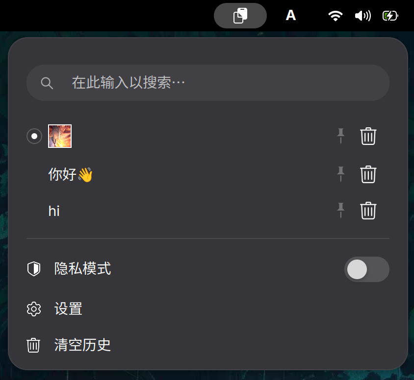

# Clipboard Indicator

A compact clipboard history extension that keeps recent text and images, with options to pin, search, and temporarily pause history.



## Use

- Use the arrow keys to move through history and Enter to select an item.
- Press `p` to pin an item or Delete to remove it.
- Press `v` to paste from the menu.
- Open **Settings** for the extension's single-page preferences.

Menu paste sends Shift+Insert (Ctrl+Shift+Insert in terminals); some applications may not accept synthetic paste keys.

## GNOME Shell support

| GNOME Shell version | Support |
| --- | --- |
| 50 | Supported |
| 51 | Supported |

## Install

```sh
mkdir -p ~/.local/share/gnome-shell/extensions
git clone https://github.com/WangWindow/gnome-shell-extension-clipboard-indicator.git \
  ~/.local/share/gnome-shell/extensions/clipboard-indicator@choco2233.io
gnome-extensions enable clipboard-indicator@choco2233.io
```
